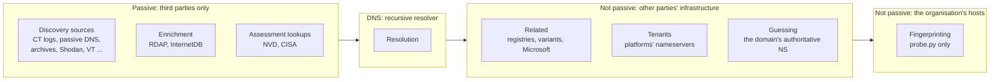

# farpoint architecture

This document explains how farpoint is built and why it works the way it does. For how to run it, its
options and its output files, see [README.md](README.md).

## Contents

- [System diagram](#system-diagram)
- [Overall methodology](#overall-methodology)
- [Core design](#core-design)
- [Stage methodology](#stage-methodology)
  - [1. Discovery](#1-discovery)
  - [2. Related domains](#2-related-domains---related)
  - [3. Resolution](#3-resolution)
  - [4. Tenants](#4-tenants---tenants)
  - [5. Guessing](#5-guessing---guess)
  - [6. Enrichment](#6-enrichment)
  - [7. Fingerprinting](#7-fingerprinting---fingerprint)
  - [8. Assessment](#8-assessment---assess)
  - [9. Merge and output](#9-merge-and-output)
- [Cross-cutting concerns](#cross-cutting-concerns)
- [Extending farpoint](#extending-farpoint)

## System diagram

### Data flow

Each stage reads what earlier stages put in the `Inventory` and adds to it. The dashed stages are
opt-in. Assessment and the merge happen after the pipeline, against the merged inventory on disk.

```mermaid
flowchart TD
    IN([root domains]) --> INV0[Inventory<br/>scan domains as seed hosts]

    subgraph PIPE["Pipeline.run  (pipeline.py)"]
        direction TB
        D[1. Discovery<br/>sources/*] --> R
        R[2. Related domains<br/>related.py]:::opt --> RES
        RES[3. Resolution<br/>resolve.py] --> T
        T[4. Tenants<br/>tenants.py]:::opt --> G
        G[5. Guessing<br/>guess.py]:::opt --> E
        E[6. Enrichment<br/>enrich.py] --> F
        F[7. Fingerprinting<br/>fingerprint.py, posture.py, probe.py]:::opt
        G -. rounds: new names' CNAME targets .-> RES
    end

    INV0 --> D
    F --> RUN[run_report<br/>this run as a dict]

    PRIOR[(out/assets.json<br/>prior inventory)] --> PREV[preview: prior + this run]
    RUN --> PREV
    PREV --> V[8a. CVE lookups<br/>NVD, CISA KEV]:::opt

    RUN --> M[9. merge_reports<br/>under a directory lock]
    PRIOR --> M
    M --> J[8b. derive findings<br/>assess.py, pure]:::opt
    V --> J
    J --> W[write every output file<br/>atomically]
    M -->|without --assess| W
    W --> OUT[(assets.json, hosts.csv, ips.csv,<br/>fingerprints.csv, findings.csv, ...)]

    PRIOR -. earlier hosts, CNAMEs, tenants,<br/>names already guessed .-> T
    PRIOR -. .-> G

    classDef opt stroke-dasharray: 5 5
```

### Who sees traffic

The stages are ordered by how much contact they make. Only `probe.py` ever opens a connection to the
organisation's own hosts.



## Overall methodology

farpoint answers one question: *what does this organisation expose to the internet, and what would an
attacker look at first?* It starts from root domains and nothing else, and builds the answer in layers.

1. **Find names from many independent witnesses.** No single dataset sees everything. Certificate
   transparency sees names that got a certificate; passive DNS sees names that were resolved; archives
   see names that served pages; scan engines see names on open ports. farpoint asks all of them and
   records, for each host, which sources reported it. Agreement between unrelated witnesses is evidence
   in itself.
2. **Verify against live DNS.** A name from a dataset may be years old. Resolution separates what
   exists now from history, and the inventory keeps both: `ips` holds every address ever seen,
   `resolved_ips` only what DNS answered this run.
3. **Widen carefully, from evidence.** Optional stages look sideways (sister domains, SaaS tenants) and
   forwards (names nobody has seen yet, predicted from the organisation's own naming). Each one ties its
   results back to the organisation with evidence and says how strong the tie is.
4. **Characterise what is live.** Fingerprinting asks each live service who it is, in the ordinary way
   any client would, and names the products and versions.
5. **Judge separately from observing.** Assessment is a pure function from facts to findings. It runs
   over the whole merged inventory every time, so findings always describe the latest facts and are
   never merged or left stale.

Five rules shape every stage:

| Rule | How it shows in the code |
|---|---|
| **Stay in scope** | `Inventory.add` drops every observation not equal to or under a scan domain. Related domains, tenants and lookalikes go to separate tables and are never probed. |
| **Escalate contact one step at a time** | Each stage beyond passive has its own flag. `--no-resolve` refuses to combine with any stage that needs DNS. `probe.py` is the only module that connects to the organisation. |
| **Use the lightest touch that answers** | Fingerprinting reads banners, does one handshake, one `GET`. No logins, payloads, credential guesses or exploit checks. |
| **Unknown is not absent** | A timeout makes `resolves` `None`, not `False`. A failed DNSSEC query makes `dnssec` unknown, not "off". A timed-out port keeps its old row. Findings are never raised from missing answers. |
| **Never lose a scan** | One failing source never sinks a run; Ctrl-C saves what was gathered; a checkpoint survives a hard kill; a failing assessment still saves the scan. |

## Core design

### Observations and the inventory (`models.py`, `names.py`)

Everything a discovery source or stage learns enters as an `Observation`: *source S saw hostname H,
optionally pointing at IP I*. Sources do nothing else. `Inventory.add` is the single choke point that:

- normalises the hostname and IP (`names.normalize_hostname`, `normalize_ip`), dropping garbage
- routes lookalikes to their own table
- drops anything out of scope
- unions the source into `HostRecord.sources` and links the host and the IP both ways

Because scoping, normalisation and de-duplication all happen here, a new source cannot leak
out-of-scope names into probing, and cannot create duplicates.

Stage results that aren't hostnames get their own records: `TenantRecord`, `RelatedRecord`,
`ServiceRecord` (one per `host:port`), and plain dicts for posture and dangling DNS. Each carries its
evidence alongside the conclusion.

### The pipeline (`pipeline.py`)

`Pipeline.run` calls the stages in a fixed order, skipping those not configured. Every stage expresses
its work as a dict of jobs keyed by `(name, target)` and hands it to `_fan_out`, which:

- gives each job name its own thread pool, sized by the source's `max_concurrency` and capped at
  `--workers`, so a throttled source only blocks its own threads
- yields successful results to the stage, which applies them to the inventory on the main thread
- records exceptions as `SourceError`s on the inventory and carries on
- calls the checkpointer after each result
- on interrupt, cancels and abandons in-flight jobs instead of waiting for them

All inventory mutation happens on the main thread, between results, so a result is never half-applied.

### Network seams

All network access sits behind small protocols, so the stage logic is tested offline with fakes:

| Protocol | Real implementation | Used by |
|---|---|---|
| `Source` | `HttpSource`, `CommandSource` subclasses | discovery |
| `lookup` / `Dns` | `resolve.DnsResolver` | resolution, tenants, guessing, posture |
| `Enricher` | `enrich.InternetDb`, `enrich.Rdap` | enrichment |
| `related.Probes` | `related.NetworkProbes` | related domains |
| `probe.Prober` | `probe.NetworkProber` | fingerprinting, posture |

`cli.py` is the only place these are wired together.

### Code layout

All in `src/farpoint/`:

| Module | Role |
|---|---|
| `cli.py` | Command line; wires the real network implementations into the pipeline |
| `pipeline.py` | Runs the stages in order; concurrency, failures, interrupts |
| `models.py`, `names.py`, `suffixes.py` | The inventory; normalising and scoping names; registered-domain boundaries |
| `sources/` | One class per discovery source, on `HttpSource` or `CommandSource` |
| `resolve.py`, `enrich.py` | DNS resolution; RDAP and InternetDB |
| `related.py`, `tenants.py`, `guess.py` | The discovery opt-ins |
| `corpus.py` | Builds the optional cross-organisation naming corpus for `guess.py` |
| `probe.py` | The only code that connects to the organisation's hosts |
| `fingerprint.py`, `posture.py` | What fingerprinting asks, and what the answers mean |
| `assess.py` | Findings; NVD and CISA lookups |
| `output.py` | Merging, checkpoints, and writing the output files |
| `runtime.py`, `progress.py` | Cancellation and per-job status; the live display |

## Stage methodology

### 1. Discovery

**Goal:** every hostname under the scan domains that any public dataset has seen.

**Method.** Every available source is run once per scan domain, concurrently (`Pipeline._collect`).
A source is a class with `available()` (key or binary present) and `collect(domain)`, which yields
observations. Unavailable sources are listed as skipped, not as failures.

- `HttpSource` (`sources/base.py`) provides throttling to the service's published rate (VirusTotal 4 a
  minute, Shodan 1 a second), retries with exponential backoff on transport errors, 5xx and 429, and
  honours `Retry-After` up to a cap.
- `CommandSource` wraps external tools (subfinder, bbot, dnstwist), runs them as tracked subprocesses so
  an interrupt kills them, and parses their output.
- dnstwist's results are marked `lookalike=True`: registered typosquats belong to anyone, so they are
  recorded but never treated as the organisation's.

**Partial results.** Each job collects into a list the pipeline can read mid-run (`_drain`). A source
that fails on page 3 keeps pages 1 and 2. On Ctrl-C, pages already fetched by sources still running are
added before saving.

### 2. Related domains (`--related`)

**Goal:** other registered domains the organisation owns, reported for a human to decide on, never
scanned.

**Method** (`related.py`, `Pipeline._related`):

1. **Microsoft 365 federation.** One Exchange autodiscover `GetFederationInformation` request per scan
   domain returns the domains verified in its tenant. Only an owner can verify a domain, so these are
   recorded `strong`. Subdomains of scan domains in the list join the inventory as source `m365`.
2. **Suffix swap.** Each scan domain's name under every suffix in `data/suffixes.txt` (all IANA TLDs
   and common second levels). An NS lookup decides whether each variant is registered. Suffixes where a
   random name also has NS records are wildcard registries and are dropped.
3. **Profiling.** Each registered variant, and each scan domain, gets a `Profile`: nameservers, MX and
   A records. Each variant also gets one HTTP request to follow its redirects, and addresses it shares
   with the scan domain get an RDAP owner lookup.
4. **Tying by evidence** (`related.tie`). Any one signal can be shared or faked (a DNS host's
   nameservers, a parking address, an affiliate redirect), so one signal alone is at most `medium`:

   | Tie | Evidence |
   |---|---|
   | `strong` | signals that agree: the organisation's own nameservers plus a shared mail host, address or redirect home; or the same nameservers plus a redirect home or the organisation's own mail host |
   | `medium` | one of those alone: its own nameservers, a direct redirect home, or its own mail host |
   | `weak` | the same nameservers at an outside provider, a shared address or generic mail host, or a redirect home through someone else's host |

   Variants with no tie go to lookalikes. A variant looked at again and no longer tied leaves the list.

### 3. Resolution

**Goal:** what each name points at now.

**Method** (`resolve.DnsResolver`, `Pipeline._resolve`). Every host gets A, AAAA and CNAME lookups
through the recursive resolver, with one retry. The result is three-state: `resolves` is `True`,
`False`, or `None` on timeout. In-scope CNAME targets are added to the inventory and resolved in the
next pass; the loop runs until no unresolved hosts remain. CNAME targets outside scope are recorded on
the host, never followed.

### 4. Tenants (`--tenants`)

**Goal:** the organisation's accounts on other companies' platforms (`example.sharepoint.com`).

**Method** (`tenants.py`, `Pipeline._tenants`):

1. **Plan, strongest evidence first** (`tenants.plan`). Candidate patterns come from, in order: tenant
   names the scan domains' TXT records state outright; platforms their TXT verification strings or SPF
   includes name (tie `records`); zones the organisation's CNAMEs point into, from this scan and earlier
   ones (tie `cname`); and every pattern in `data/tenants.json` (tie `name`).
2. **Build names.** The organisation's token is each scan domain's first label. For platforms its
   records name, the organisation's most used modifiers (learned with the guessing taxonomy) are tried
   too: `example-dev`.
3. **Budget.** Patterns are taken in order until `--tenant-budget` lookups are spent, three random-name
   probes per pattern included.
4. **Wildcard control.** Each pattern is first tried with three random names. If they resolve, the
   platform answers anything, and a candidate counts as `verified` only if it answers differently (its
   own address or alias). If the platform can't be told apart, a candidate is kept as unverified only
   when the organisation's own records name that platform. If the probes time out, the pattern is
   skipped and an error recorded.
5. **CNAME tenants.** Any out-of-scope CNAME target carrying the organisation's name
   (`example-files.vault.io`) is recorded as a tenant with tie `cname`.

### 5. Guessing (`--guess`)

**Goal:** names no dataset has seen, predicted from how this organisation names things.

**Model** (`guess.Taxonomy`). Every known name, including CNAME targets and earlier scans' hosts, is
split into labels and each label into tokens: `app2-service-dev` → `app` `2` `-service` `-dev`. The
first token is the stem, later word tokens are modifiers. Run-together labels (`portaltest`) are split
with a dictionary taken from a cross-organisation popularity ranking of subdomain labels. Candidates are
scored from several kinds of evidence, each contributing its best score once, and ranked by the sum:

| Evidence | Example |
|---|---|
| Modifiers a stem lacks, weighted by co-occurrence with its own modifiers on other stems | `api-dev` → `api-prod` |
| The other separator, a dropped modifier, nearby numbers | `portaltest` → `portal-test`; `app2` → `app3` |
| Words from the organisation's verified tenants (tried first) | `example-mft.vendor.co` → `mft` |
| Prefixes reused over many names | `www.` |
| Names repeated across the scan domains | `vpn.a.com` → `vpn.b.com` |
| Popular standalone names | `files`, `sftp` |
| Optional cross-organisation corpus (`data/corpus.json`) | modifiers other organisations pair |

Names never seen with an address (often a source's junk) count for less as evidence. No word list is
hand-picked for an organisation; the weights were tuned with leave-one-out runs on unrelated
inventories.

**Search** (`Pipeline._guess`). The per-domain budget is split over three rounds plus a small follow-up
round. Each round takes the best untried candidates within its share, tests them, and if anything
resolved, rebuilds the model so the next round tries the new names' variants. New names' in-scope CNAME
targets are resolved between rounds. Every tested name is stored in `assets.json`; later scans into
the same folder skip it for 90 days, so repeated scans go further down the ranking.

**Wildcard control.** Before guessing under a parent name, three random names there are looked up:

- they resolve: a guess counts only if it has an address or alias the wildcard doesn't give
- they time out: nothing is guessed there (the budget is returned)
- most guesses under one parent resolve anyway (at least 10, over half): all are discarded as
  wildcard-like DNS whose addresses rotate past the probes

**Offline evaluation.** `python -m farpoint.guess OUT_DIR` hides each known host in turn and reports how
often the model ranks it within 100, 500 and 2000 guesses, with no DNS traffic. `farpoint.corpus` builds
and cross-validates the optional corpus from organisation-validated certificates in CT logs.

### 6. Enrichment

**Goal:** who owns each address and what scanners have seen on it, without touching it.

**Method** (`enrich.py`, `Pipeline._enrich`). Every public address gets an RDAP lookup (owner and
network, via the IANA bootstrap registries) and a Shodan InternetDB lookup (historical ports, CVEs,
hostnames, tags such as `cdn`). In-scope hostnames InternetDB reports join the inventory. Enrichment
runs after guessing so guessed hosts' addresses are covered.

### 7. Fingerprinting (`--fingerprint`)

**Goal:** what each live host runs, and how each scan domain's mail and DNS are set up.

**Targets.** Only in-scope hosts that resolve now, at public addresses DNS returned this run. Passive
DNS history is excluded: an old address may belong to someone else today. Each host is probed at one
address.

**Shared front ends** (`fingerprint.shared_address`). An address owned by a CDN or SaaS provider
(from RDAP org, InternetDB tags and the hosts' CNAMEs) is the provider's machine, so only ports 80 and
443 are tried there. Addresses behind CNAMEs to cloud VMs or load balancers count as the organisation's.

**The steps:**

1. **Port sweep.** One TCP connect per port: the 43 defaults (or `--ports`) plus ports InternetDB saw
   open. Each port is `open`, `closed` (refused) or `filtered` (timed out). Only a refusal removes an
   old fingerprint row; a timeout might be one dropped packet.
2. **Service identification** (`fingerprint_service`). Each open port is asked by port class:

   | Class | Ports (examples) | What is asked |
   |---|---|---|
   | SMTP | 25, 587 | banner, `EHLO`, `STARTTLS`; never `MAIL FROM` |
   | TLS first | 443, 8443, 10443 | handshake, then HTTPS |
   | HTTP first | 80, 8080, 9200 | HTTP, then TLS if that fails |
   | Implicit TLS | 465, 993, 636 | handshake for the certificate |
   | Silent binary | 445, 3389, 5432, 6379 | nothing past the connect |
   | Unknown | anything else | read a greeting; if none, try TLS and HTTP |

   Web requests are `GET /` (following redirects within the same service, up to 3), the favicon
   (hashed the way Shodan does), and the `--paths`. TLS ports also get TLS 1.0 and 1.1 handshakes unless
   `--no-legacy-tls`. Web and unknown ports are asked per hostname, since virtual hosts differ; other
   services are asked once per address and copied to each hostname there.
3. **Technology matching** (`fingerprint.identify`). Everything a service said is collected into
   `Evidence` (headers, cookies, title, body, redirect, banner, CNAMEs, generator, certificate) and
   matched against the rules in `data/fingerprints.json`. A rule's first capture group is its version,
   which fills the rule's CPE template. WordPress plugins and themes are read from asset URLs. Signals
   such as `directory-listing`, `basic-auth`, `git-exposed` and `takeover:<platform>` are recorded too.
4. **Domain posture** (`posture.assess_domain`), per scan domain, almost all through DNS:
   - mail: provider from MX; SPF (`all`, lookup count against RFC 7208's 10, includes that don't
     exist or sit on unregistered domains); DMARC `p`, `sp`, `pct`; DKIM key sizes under 32 common
     selectors; MTA-STS (the policy is fetched over verified HTTPS), TLS-RPT, BIMI
   - DNS: nameservers, one `AXFR` request to each, DNSSEC, CAA, wildcard
   - registration: registrar, dates and transfer lock from RDAP

   Each part fails independently. A failed check is recorded as an error and its value left unknown.
5. **Mail servers** (`posture.check_mx`). MX hosts under the organisation's own domains get one SMTP
   connection for banner, STARTTLS and certificate. Hosted providers' (Microsoft 365, Google, mail
   gateways) are left alone.
6. **Dangling DNS** (`pipeline._dangling`). For each name that doesn't resolve, its CNAME target is
   checked. A target under an unregistered domain, or a nonexistent name on a platform where names can
   be claimed (`data/takeover.json`), is a takeover risk. So is a live host serving a platform's
   "nothing configured here" page. A target that simply doesn't exist is a broken record.

**Pacing.** Connections are paced across the scan by `--probe-rate` (default 20 a second), with at most
2 in flight to one address (`probe.PER_IP`), and identify themselves with a `farpoint/0.1` user agent.

### 8. Assessment (`--assess`)

**Goal:** a ranked list of what an attacker choosing a soft target would try first.

Assessment has two halves, deliberately separated:

**a. Lookups** (`assess.lookup_vulns`), done before saving against a *preview* of the merged inventory
(`output.preview`), so that previously fingerprinted hosts are covered too. For each CPE with a version,
NVD is asked which CVEs affect it (cached in `assets.json` for 7 days). CISA's Known Exploited
Vulnerabilities catalogue is fetched once. These are the only network calls, and none goes to the
organisation. If interrupted, the scan is saved without a new assessment.

**b. Derivation** (`assess.derive`), a pure function from the merged report to findings, run inside
the save. It walks:

- each fingerprinted endpoint: exposed management and data ports, edge appliances and admin panels by
  technology category, end-of-life versions (`data/eol.json`), CVEs, certificate and TLS problems, web
  signals, dev/test hosts
- each address's Shodan CVEs
- dangling DNS: claimable targets are takeovers (high), the rest broken CNAMEs (low)
- each domain's posture: SPF, DMARC, DKIM, MTA-STS, STARTTLS, AXFR, DNSSEC, CAA, registration expiry
  and transfer lock

**Ranking.** `level` is attacker interest, not CVSS:

| Level | Meaning | Examples |
|---|---|---|
| high | tried first | RDP/SMB/databases/container APIs open; VPN appliances; Jenkins, GitLab, Exchange; known-exploited or CVSS ≥ 9 CVEs; end-of-life software; exposed `.git`; takeovers; spoofable mail; zone transfers |
| medium | useful weakness | self-signed or mismatched certificates; TLS 1.0/1.1; HTTP only; directory listings; login prompts; dev/staging hosts; weak DKIM |
| low | hygiene | missing HSTS; no DNSSEC or CAA; version-revealing headers; broken CNAMEs |

**Discounts**, to avoid confident false positives:

- a distribution package version (`OpenSSH_8.9p1 Ubuntu`) is capped at medium unless the CVE is known
  to be exploited, because distributions backport fixes
- Shodan CVEs on a shared CDN or SaaS address are low: the provider's to fix
- a check that failed produces no finding

Each finding has a stable `id`. Because findings are re-derived from scratch each time, a fixed issue
disappears; `merge_findings` only carries over `first_seen`. `farpoint --assess -o DIR` with no domains
re-judges an existing inventory without scanning (`output.rewrite`).

### 9. Merge and output

**Goal:** an inventory that accumulates across scans, and files regenerated from it.

**Method** (`output.py`). `run_report` turns this run's inventory into a dict. `write_outputs` then,
under a directory lock:

1. loads the prior `assets.json` and merges (`merge_reports`). Each kind of row merges by its own rule:

   | Kind | Rows | Rule |
   |---|---|---|
   | Accumulating facts | hosts, IPs, lookalikes, tenants | sets unioned; `resolves` and owner take the latest answer |
   | Latest look | fingerprints, posture, related | replaced when looked at again; a refused port removes its row; a timeout keeps it with its old `last_seen` |
   | Judgments | findings | re-derived each time |

2. runs the assessment's derivation on the merged report, if requested. If it raises, the scan is saved
   unjudged with the error recorded.
3. writes every file atomically (temp file and rename). `assets.json` is the source of truth; the CSVs
   and text lists are views of it.

Every row carries `first_seen` and `last_seen`. Each run is recorded with its domains, counts of new
rows, errors and skipped sources. If the prior inventory is unreadable, the scan refuses to start; if
it becomes unreadable mid-scan, this run is saved beside it as `assets.unmerged-<time>.json`.

## Cross-cutting concerns

### Cancellation and progress (`runtime.py`, `progress.py`)

`runtime` holds per-process state: which job each worker thread is on, and a cancellation event.
Sources call `runtime.status()`, `count_request()` and `sleep()` without knowing who is listening; the
pipeline binds each worker to its job key and the reporter. `progress.LiveReporter` draws a line per
source and domain plus counters for each later phase; `NullReporter` is used with `-v` or when output
isn't a terminal.

Ctrl-C and SIGTERM are only delivered to the main thread while it waits for the next result
(`runtime.interruptible`); arriving at any other time they are deferred to the next wait. Cancelling
wakes every `runtime.sleep` and terminates tracked subprocesses. The first signal stops the scan and
saves; a second exits without saving. During the save, signals no longer stop anything.

### Checkpoints (`output.Checkpointer`)

At most every 5 seconds the in-progress inventory, including pages from jobs still running, is written
to `.checkpoint-<pid>-<random>.json`, with an exclusive lock held on a matching `.lock` file. The next
run into the folder merges any checkpoint whose lock is free (`recover_checkpoints`). Liveness is decided
by the lock, not the PID, since PIDs are reused.

### Rate limits and politeness

| Where | Control |
|---|---|
| Discovery and enrichment APIs | per-service throttle and pool size; backoff with `Retry-After` |
| Related domains | 8 concurrent lookups |
| Tenants | `--tenant-budget` total lookups |
| Guessing | `--guess-budget` per domain, `--guess-rate` per second |
| Fingerprinting | `--probe-rate` per second; 2 connections per address; web-only on shared front ends |
| NVD | about 1 request every 6 seconds without `NVD_API_KEY`; 7-day cache |

### Bundled data (`src/farpoint/data/`)

| File | Used by | Contents |
|---|---|---|
| `subdomains.txt` | guessing | cross-organisation subdomain label ranking; also the word-splitting dictionary |
| `suffixes.txt` | related | every suffix tried in the swap |
| `public_suffixes.txt` | `suffixes.py` | public suffix list, for registered-domain boundaries |
| `tenants.json` | tenants | vendors, tenant name patterns, TXT and SPF markers |
| `fingerprints.json` | fingerprinting | technology rules: matchers, category, CPE template |
| `takeover.json` | fingerprinting | claimable platforms and their "unclaimed" page signatures |
| `dkim_selectors.txt` | posture | the common DKIM selectors checked |
| `eol.json` | assessment | end-of-life dates by product and version |
| `corpus.json` (optional, not bundled) | guessing | cross-organisation naming statistics |

### Testing

The offline suite (`uv run pytest`) exercises every stage through fake `Source`, `lookup`, `Dns` and
`Prober` implementations, so no test touches the network. Tests marked `network` are smoke tests
against real DNS, `example.com` and NVD.

### Known limits of the design

- Hostnames InternetDB reports during enrichment join the inventory after resolution, so they are not
  resolved or fingerprinted until the next scan.
- Fingerprinting covers hosts found live in this scan, not hosts known only from earlier scans.
- Technology and CVE matching is by what services reveal and by version; products that hide their
  banner are missed, and CVE matches are leads to confirm.
- DKIM is checked under common selectors only.
- Directory locking uses `fcntl`, so on Windows two concurrent scans into one folder are not protected.

## Extending farpoint

- **A discovery source:** subclass `HttpSource` or `CommandSource` in `sources/`, yield `Observation`s
  (`HttpSource.observe` builds them), and register it in `sources/__init__.py`. Scoping and de-duplication are
  handled by the inventory.
- **A technology:** add a rule to `data/fingerprints.json`. Put the version in the first capture group
  and give a CPE template if NVD should be asked about it.
- **A tenant platform:** add a vendor to `data/tenants.json` with its name patterns and any TXT or SPF
  markers that show a domain uses it.
- **A takeover platform:** add it to `data/takeover.json` with its CNAME pattern and unclaimed-page
  signature.
- **A finding:** add it to `assess.derive` or one of its helpers. Keep it a pure function of the report,
  and raise nothing when the underlying check's answer is unknown.
